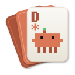
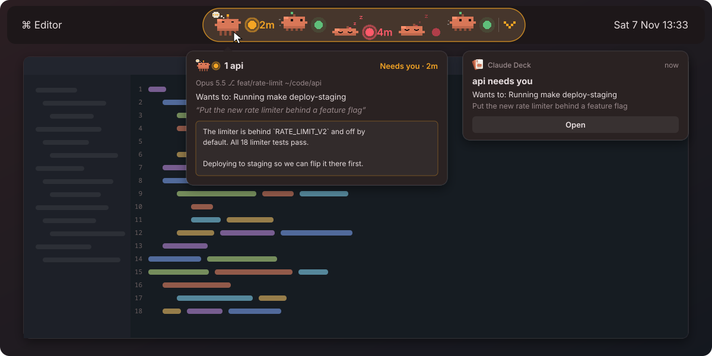
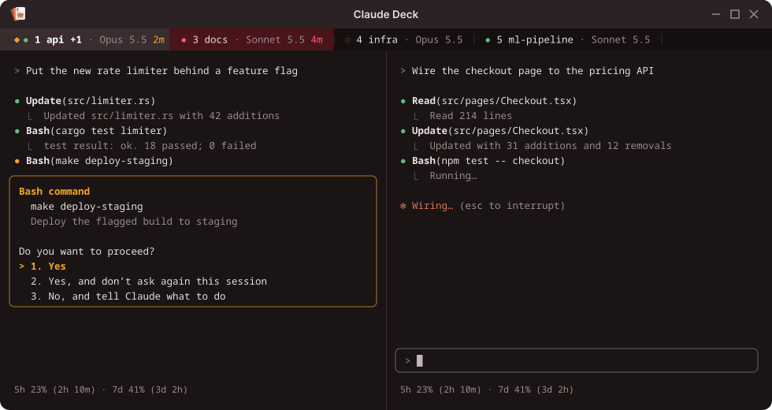
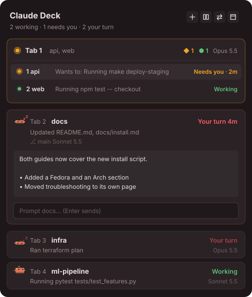
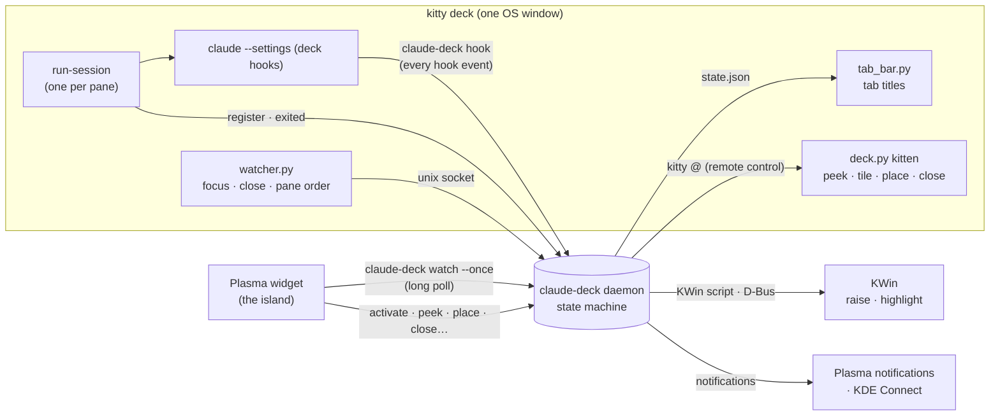

<div align="center">



# claude-deck

**Run many Claude Code sessions in one terminal deck,<br>and see what each of them needs right on your KDE Plasma panel.**

[](https://github.com/borislisandro/claude-deck/actions/workflows/ci.yml)


[](LICENSE)


</div>

## Why

You start a few Claude Code sessions in different repos and switch to something else. One is
waiting on a permission prompt, one finished ten minutes ago, one is still working, and nothing
tells you which is which.

claude-deck puts all of them in **one kitty window** (tabs and splits) and adds **an island to your
Plasma panel** with a pixel critter per session, so you always know who needs you:

<p align="center"></p>

It reads Claude Code's own hooks (no screen scraping), never touches your `~/.claude/settings.json`,
and has no network code of its own.

## What it's good for

**Keep working elsewhere until Claude actually needs you.** A critter turns yellow and one
notification says what it wants. Hover to peek, click to jump straight to that pane.

<p align="center"></p>

**Run several agents in parallel**, across repos or side by side in one. Tab titles show which
session needs you, which is working and which is done.

<p align="center"></p>

**Triage from the panel.** The popup lists every session by tab. Read Claude's latest message,
send a prompt, or drag a session into another tab without opening the deck.

<p align="center"></p>

**And:** one "while you were away" summary after a game or fullscreen video · **Meta+Shift+C**
jumps to whoever waited longest · quit at night and restore every conversation tomorrow ·
optional pings to your phone through KDE Connect.

## Does it run on my system?

**Linux with KDE Plasma 6**, on Wayland or X11. Fedora, Arch and its derivatives, openSUSE
Tumbleweed, KDE neon, Kubuntu 24.10+ and Debian 13 all qualify. Plasma 5 and other desktops
don't.

<details>
<summary><b>Distribution details and requirements</b></summary>

| Distribution | Status | Notes |
|---|---|---|
| **Fedora** 40+ KDE Plasma edition | ✅ Supported | Developed and used daily on Fedora 44 (Plasma 6.8, Wayland, kitty 0.47). |
| **Arch Linux**, EndeavourOS, Manjaro, CachyOS (KDE) | ✅ Supported | Rolling, always on current Plasma 6. |
| **openSUSE** Tumbleweed / Slowroll (KDE) | ✅ Supported | |
| **KDE neon** | ✅ Supported | Ubuntu base with current Plasma 6. Use rustup for Rust. |
| **Kubuntu** 24.10 or newer | ✅ Supported | Use rustup: the packaged Rust may be older than 1.85. |
| **Debian 13** "trixie" (KDE) | ✅ Supported | Ships Plasma 6.3. |
| Fedora Kinoite, Bazzite, Aurora and other atomic KDE spins | ⚠️ Should work | Everything installs in your home folder. Build inside a toolbox or distrobox, and get kitty by layering it or with kitty's own installer. |
| NixOS with Plasma 6 | ⚠️ Should work | Not tested. The installer writes to `~/.local` and needs `kitty`, `cargo`, `gdbus` and `kpackagetool6` on PATH. |
| Plasma 5: Kubuntu/Ubuntu 24.04 LTS and older, Debian 12, openSUSE Leap 15 | ❌ Not supported | The panel widget needs Plasma 6. |
| GNOME, Xfce, Cinnamon, Hyprland, Sway… | ❌ Not supported | Without Plasma there is no island, no global shortcuts and no raising through KWin. The deck itself runs, but the installer expects Plasma and this setup is untested. |
| macOS, Windows, WSL | ❌ Not supported | |

**You need:** KDE Plasma 6 · [kitty](https://sw.kovidgoyal.net/kitty/) · a recent
[Claude Code](https://docs.anthropic.com/en/docs/claude-code/overview) (`claude` on your PATH, in
`~/.local/bin` or in `~/.claude/local`) · Rust 1.85+ · `gdbus` (GLib) · `kpackagetool6` (comes with
Plasma). Optional: `pw-play` for sounds, `kdeconnect-cli` for phone pings.

</details>

## Install

```sh
git clone https://github.com/borislisandro/claude-deck
cd claude-deck
packaging/install.sh --add-to-panel   # builds into ~/.local/bin, installs the widget and shortcuts
claude-deck doctor                    # checks that everything is in place
```

No root needed. Reinstalling (`git pull && packaging/install.sh`) never closes your sessions.

<details>
<summary><b>Prerequisites for your distribution</b></summary>

```sh
sudo dnf install kitty rust cargo glib2                    # Fedora
sudo pacman -S --needed kitty rust glib2                   # Arch, EndeavourOS, Manjaro, CachyOS
sudo zypper install kitty rust cargo glib2-tools           # openSUSE Tumbleweed / Slowroll
sudo apt install kitty libglib2.0-bin kpackagetool6        # Debian 13, Kubuntu, KDE neon…
curl --proto '=https' --tlsv1.2 -sSf https://sh.rustup.rs | sh   # …plus a current Rust from rustup
```

Then install [Claude Code](https://docs.anthropic.com/en/docs/claude-code/overview) if you haven't,
and sign in once by running `claude`.

</details>

<details>
<summary><b>What the installer does, updating and uninstalling</b></summary>

- Builds the binary into `~/.local/bin` (make sure it's on your PATH; `doctor` warns you if not).
- Installs the panel widget, the icon and a launcher ("Claude Deck", with jump lists for *New
  Session*, *Restore* and *Quit*).
- Registers the global shortcuts **Meta+C** and **Meta+Shift+C**.
- With `--add-to-panel`, places the island on your top panel (left of your first system monitor
  widget, if you have one) and binds **Meta+Alt+C** to its popup. Without it, add "Claude Deck"
  through *Add Widgets*.

**Updating:** `git pull && packaging/install.sh`. The installer runs `claude-deck upgrade`, which
hands the running deck over to the new binary.

**Uninstalling:** remove the widget from your panel first (or Plasma shows a placeholder where it
was), then run `packaging/install.sh --uninstall`. Your saved workspace in
`~/.local/state/claude-deck` is kept.

**Try it first:** `claude-deck daemon --demo`, run while the deck is closed, cycles fake sessions
through every state on your panel, with no kitty and no Claude involved. Ctrl+C stops it.

</details>

## How to use it

1. **Meta+C** (or `claude-deck`) opens the deck and a project picker.
2. **F4** adds a session in a new tab, **F5** beside this one, **F6** below.
3. Go do something else. Yellow means Claude needs you, a sleeping critter means it's done.
   Click it, or press **Meta+Shift+C** from anywhere.
4. Quit when you're done. Next time, the picker or **Ctrl+Shift+R** restores every conversation.

### More

<details>
<summary><b>Reading the state: critters, tab titles, the exit menu</b></summary>

| State | Critter | Light | Means |
|---|---|---|---|
| **Working** (green) | runs, kicking up dust | breathes | Claude is thinking or running tools. Nothing to do. |
| **Needs you** (yellow) | hand on chin, thought bubble | pings: dims as a quick ripple leaves it | A permission prompt, a question (`AskUserQuestion`), a plan to approve, or an MCP server asking something. |
| **Your turn** (red) | asleep, Z's floating up | slow ripple until you've looked | The turn is over and Claude waits for your next prompt. Once you've looked, the light dims and stops rippling. |
| **In background** (purple) | awake, glancing around | breathes slowly | The turn is over, but Claude left a build, a server or an agent running and comes back by itself when it finishes. No notification; the session opened up lists what's running. |
| **Exited** (grey) | grey, eyes shut | hollow ring | Claude quit or crashed. The pane stays open with a menu. |

The critter in the popup's header belongs to no session: it sums up the whole deck. It waves
with a `!` when anyone needs you, juggles (a ball per session) when everything is working,
types at a laptop when only some sessions are, and has a coffee when they all wait on you.
Sessions waiting on background work count as busy here.

A session that has waited unseen for over a minute shows its wait time beside the light (`4m`).
A turn that ended on an API error (rate limit, overload) gets a small red `!`.

The island always follows the deck's order: tabs left to right, and panes within a tab in reading
order. Move a tab and the island follows. With more than 5 sessions (configurable) the island
shows one critter per tab: the tab's most urgent session, with a count badge. With more than 5
tabs as well, it shows one count per state.

Inside the deck, each kitty tab title carries the same information:

```
 ◆● 1 api +1 · Opus 5.5 2m │ ● 3 docs · Sonnet 5.5 4m │ ○ 4 infra
 │└ the other session in the tab                         └ seen: dimmed
 └ the most urgent session leads: needs you, waiting 2 minutes
```

When a session ends, its pane doesn't vanish:

```
────────────────────────────────────────
  Claude exited with code 1.

  [r] or Enter resume this conversation   [n] start a new one   [q] close the pane
```

Only `q` closes. Enter resumes, so a habitual keypress right after a crash can't throw the
session away.

</details>

<details>
<summary><b>The island and its popup</b></summary>

The island is a Plasma 6 widget (`com.borislisandro.claudedeck`). It only takes space while the
deck runs; otherwise it is zero pixels wide.

| On the island | Does |
|---|---|
| **Hover a critter** | After a short pause, kitty switches to that session's tab without taking focus, and the deck window is highlighted (the same effect the task manager uses). A card shows project, branch, model, state, last action, last prompt and the end of Claude's latest message. |
| **Click a critter** | Focuses that pane and raises the deck. Clicking the session you're already in hides the deck. |
| **Middle-click** | New session (with the picker). |
| **Scroll** | Switch to the next or previous session. |
| **Click the chevron** | The popup. It sits at one end of the pill (right by default), so a click that just misses a critter never opens it. |
| **Right-click** | New session, show sessions, jump to next waiting, tile, spread into tabs, restore, quit. |
| **Meta+Alt+C** | Opens the popup (set by `install.sh --add-to-panel`; change it in the widget's settings). |

**The popup** slides out of the panel and lists your sessions grouped the way the deck has them.
Everything starts folded, and the popup is exactly as tall as what it shows:

- A tab with one session is a card: state, wait time, what it's doing, branch, model.
- A tab with several sessions is a header (state counts, the shared model, spread into tabs,
  close tab); click it to list its sessions, one line each.
- Click a session anywhere to open it in the deck; drag it onto another tab to tile it there.
- Its arrow opens it up: Claude's latest message in full, and a box to prompt that session from
  the popup. Enter sends, Shift+Enter is a new line, and while Claude works the message is queued.
  The box is off while Claude is asking you something, since typing would answer that.
- Close buttons ask inline ("Close?") when Claude is busy, and the popup stays open, so you can
  close several in a row.

**Attention:** while anything waits unseen, the widget reports *needs attention* to Plasma, so
the pill gets a colored border and a slow glow.

**Motion** follows Plasma's animation speed (System Settings → General Behavior). Set it to
instant and nothing in the widget moves: the critters hold their pose and the lights sit still,
still colored by state. Nothing animates while it's off screen either, such as a closed popup.

**Raising the deck** goes through a short-lived KWin script, so it works from the panel, from a
notification and from a global shortcut, despite Wayland's focus-stealing prevention.

**Panel Colorizer:** if you use it to draw panel islands, turn off *Draw the island background*
in the widget settings (`install.sh --add-to-panel` does this for you, and adds a spacer so the
critters get an island of their own).

</details>

<details>
<summary><b>Notifications: what you get and what you don't</b></summary>

The deck tries to tell you what you need to know once, and then leave you alone.

| When | What you get |
|---|---|
| A session **needs you** and you're not in the deck | A notification that stays until handled: *"api needs you"*, then what it wants (`Wants to: Running make deploy`, `Asking: Postgres or SQLite?`, `Plan ready for your review`) and the prompt it was working on. |
| A session **finishes** and you're not in the deck | *"api is done"* and the first line of what Claude said. It times out after 15 s and stays in Plasma's history. |
| A turn **ends on an error** | *"api stopped on an error"* with the error. |
| Claude **dies while busy or waiting on you**, and you weren't looking | *"api: Claude exited unexpectedly"*. Closing a pane or quitting the deck doesn't count. |
| A session has been **blocked on you** for `remind_after_min` | One reminder. Finished sessions get none: they lose nothing by waiting. |
| You come back from a **fullscreen app** | One summary of what began waiting meanwhile. Not for what has been red since this morning, and not when the deck itself was the fullscreen window. |
| A **usage limit** you had nearly used resets | One notification (see *Usage limits*). |

What you *don't* get:

- **Notifications while you're in the deck** (its window has focus): the tab bar and the island
  already show it, and the pane is right there. Hovering the island doesn't count as being in the
  deck.
- **Stacks.** A session has one notification slot, so a new state replaces the old one, and a
  summary replaces the previous summary. Two sessions with the same project name are told apart
  by branch (`api (feat/x)`).
- **Stale ones.** Looking at a session, answering its prompt, or its moving on withdraws its
  notification. A new daemon (after `upgrade`, or a crash) takes down what the old one left behind
  and shows the ones still owed.
- **Chime bursts.** Sounds closer than 2.5 s apart play once.

While a prompt is open, other work doesn't clear it: a background subagent finishing tool calls
leaves your "needs you" yellow until you've answered it.

</details>

<details>
<summary><b>Usage limits</b></summary>

Claude Code tells only its status line how full your 5-hour and weekly limits are and when they
reset (Pro, Max and Ultra plans). Deck sessions therefore run with `claude-deck statusline` as
their status line: it hands the numbers to the daemon, and shows `5h 23% (2h 10m) · 7d 41% (3d 2h)`
under the prompt. The island's popup shows what is left of each, right under its title, with
when it resets. When a window's reset time passes, the daemon tells you, with a notification, a
sound, and a phone ping if you enabled those. The daemon keeps its own clock, so it tells you even
after every session is closed.

- If `~/.claude/settings.json` has a status line of your own, it stays the one that is shown
  (the deck only listens in). A status line set in a *project's* settings is replaced in deck sessions.
- A status line makes Claude hide `esc to interrupt` from its footer; the deck recognises Claude's
  spinner line instead, so cancelled prompts are still caught.
- Nothing is announced for windows that were barely used, or that reset while the computer slept.

</details>

<details>
<summary><b>All key bindings</b></summary>

| Where | Key | Does |
|---|---|---|
| anywhere | **Meta+C** | open / show / hide the deck |
| anywhere | **Meta+Shift+C** | jump to the session waiting longest |
| anywhere | **Meta+Alt+C** | open the island's popup |
| deck | **F4** | new session in a new tab next to this one (picker; Enter keeps this folder) |
| deck | Shift+F4 | new tab, same folder, no picker |
| deck | **F5** / Shift+F5 | new session side by side (same folder / pick one) |
| deck | **F6** / Shift+F6 | new session below (same folder / pick one) |
| deck | **F7** | close the pane (asks first; Enter confirms, Esc keeps it) |
| deck | Shift+F7 | move the pane out into its own tab |
| deck | **F8** | zoom the pane on/off |
| deck | **Ctrl+Shift+Space** | jump to the session waiting longest |
| deck | Ctrl+1 … Ctrl+9 | go to session N (the island's numbering) |
| deck | **Alt+Left / Alt+Right**, Ctrl+PgUp / Ctrl+PgDn | previous / next tab |
| deck | Ctrl+Shift+PgUp / PgDn | move the tab left / right (the island follows) |
| deck | Ctrl+Shift+O | session overview (Enter or 1–9 jumps) |
| deck | Alt+Up / Alt+Down, Alt+h/j/k/l | move between panes |
| deck | Alt+Shift+arrows | move the pane |
| deck | Ctrl+Alt+Shift+arrows | resize the pane |
| deck | Ctrl+Shift+L | cycle layouts (splits, tall, grid, stack) |
| deck | Ctrl+Shift+G / Ctrl+Shift+U | tile every session in one tab / spread every tab back out |
| deck | Ctrl+Shift+R | restore the last workspace |

Ctrl+Shift+N, Ctrl+Shift+Enter, Ctrl+Shift+- and Ctrl+Shift+W do the same as F4, F5, F6 and F7.
Ctrl+Shift+Alt+Enter is Shift+F5. Add your own deck-only keys in
`~/.config/claude-deck/kitty.conf`.

</details>

<details>
<summary><b>Command line</b></summary>

```sh
claude-deck                    # open the deck; from a project folder, a session there
claude-deck ls                 # sessions and their states
claude-deck doctor             # check kitty, claude, the config, the daemon, the widget
claude-deck new ~/code/api --placement vsplit  # tab | vsplit | hsplit | window; --pick for the picker
claude-deck next-waiting --raise
claude-deck tail <sid> --lines 20              # the last lines of a session's pane
claude-deck reply <sid>                        # Claude's latest message in a session
claude-deck send <sid> run the tests           # type a prompt into a session and submit it
claude-deck place <sid> --next-to <kitty window> --side left   # no --next-to: its own tab
claude-deck panes              # every tab's panes and where they sit, as JSON
claude-deck watch              # the full state as JSON, a line per change
claude-deck restore            # reopen the saved workspace (skips what is already open)
claude-deck upgrade            # swap in a newly built binary; the deck and its sessions stay
claude-deck quit               # save the workspace and close the deck
```

`claude-deck --help` lists everything else (activate, goto, peek, ack, tile, untile, close,
close-tab, interrupt, digest, overview…). `watch` and `ls` make it easy to script around the
deck, for example to feed your own status bar.

</details>

<details>
<summary><b>Configuration</b></summary>

**The island:** right-click it, then *Configure Claude Deck…*

| Setting | Default |
|---|---|
| Hovering a session on the island shows its pane | on |
| After a fullscreen app closes, open the popup if sessions are waiting | on |
| Show how long a session has waited | on |
| Animate the critters | on |
| Claude-orange critters (off: the panel's text color) | on |
| Draw the island background (off: let Panel Colorizer style it) | on |
| Session list button | right end |
| Collapse above N sessions | 5 |
| Colors for working / needs you / your turn / in background / exited | green / amber / red / purple / grey |
| Path to the `claude-deck` binary | `~/.local/bin/claude-deck` |

**The daemon:** `~/.config/claude-deck/config.json`. Every key is optional; the daemon reads it
at start. `claude-deck doctor` tells you if the file doesn't parse; the deck then uses the
defaults and says so in its log.

```json
{
  "notify": true,
  "remind_after_min": 5,
  "kdeconnect_after_min": 0,
  "sounds": false,
  "sound_needs_you": "/usr/share/sounds/freedesktop/stereo/message-new-instant.oga",
  "sound_your_turn": "/usr/share/sounds/freedesktop/stereo/complete.oga",
  "notify_usage_reset": true,
  "usage_reset_min_percent": 80,
  "sound_usage_reset": "/usr/share/sounds/freedesktop/stereo/service-login.oga",
  "color_tabs": true,
  "claude_args": ["--model", "opus"],
  "project_roots": ["~/code"]
}
```

| Key | Does |
|---|---|
| `notify` | Desktop notifications when a session turns yellow or red while you're away from the deck. |
| `remind_after_min` | Remind once more when a session has been blocked on you this many minutes (0: never). Not sent while you're in the deck, and not for finished sessions. |
| `kdeconnect_after_min` | Ping your phone through KDE Connect after this many minutes unseen, finished or blocked (0: never). Not while you're in the deck. |
| `sounds`, `sound_needs_you`, `sound_your_turn` | Play a sound (through `pw-play`) on those transitions. |
| `notify_usage_reset`, `usage_reset_min_percent`, `sound_usage_reset` | Say so when your 5-hour or weekly usage limit resets, but only if that window was at least this full (percent) when it did. Uses `notify`, plays the sound when `sounds` is on, and pings your phone when `kdeconnect_after_min` is set. See *Usage limits*. |
| `color_tabs` | Tint the kitty tab of a session waiting on you. |
| `claude_args` | Extra arguments for every `claude` the deck starts. |
| `project_roots` | Folders whose subfolders the picker lists. |

**Kitty, for the deck only:** `~/.config/claude-deck/kitty.conf` is read after the deck's own
settings, so it can override them.

</details>

<details>
<summary><b>Troubleshooting</b></summary>

Start with **`claude-deck doctor`**. It checks kitty, `claude`, your config file, the daemon, the
hook settings, `gdbus`, the widget and your PATH, and tells you what's missing.

| Symptom | Try |
|---|---|
| The island isn't on the panel | It only shows while the deck runs: press Meta+C. Otherwise add it via *Add Widgets → Claude Deck*. |
| Meta+C does nothing | Run `packaging/install.sh` again (it registers the shortcuts), or set them in *System Settings → Shortcuts → Claude Deck*. |
| A session stays green after it finished | Was it started outside the deck? Only deck panes report hooks. Check `~/.local/state/claude-deck/daemon.log`. |
| Panel shows nothing but the deck runs | The widget can't find the binary: set its path in the widget's settings. |
| Notifications appear late | Plasma holds them in fullscreen; you'll get the "While you were away" summary when you leave it. |
| You edited the deck's kitty config and it was reset | It's generated; put your changes in `~/.config/claude-deck/kitty.conf`. |
| Something looks stuck | `claude-deck upgrade` restarts the daemon without closing anything. |

</details>

<details>
<summary><b>How it works</b></summary>



In short: every deck pane starts `claude` with an extra settings file that adds the deck's hooks
on top of yours. Each hook event goes to a small Rust daemon over a private unix socket, the
daemon's state machine decides what each session is doing, and kitty's tab bar and the Plasma
widget both draw from that state.

- **Every deck pane runs `claude-deck run-session`**, which starts
  `claude --settings <runtime>/settings.json`. Claude layers that file on top of your own
  settings, so every hook event also runs `claude-deck hook`. Your `~/.claude/settings.json`
  is never modified.
- **`claude-deck hook`** reads the event, keeps only what the deck shows (tool inputs can be
  megabytes), and hands it to the daemon over a `0600` unix socket in `$XDG_RUNTIME_DIR`. It
  prints nothing, because some hooks' output reaches Claude's context. It always exits 0 and gives
  up after 200 ms. It waits for the daemon to apply the event before exiting, so events arrive in
  the order Claude fired them.
- **The daemon** (`src/daemon.rs`) owns the session store and the deck's kitty process. Its state
  machine (`src/state.rs`) is pure, with no I/O and no clock, and is unit-tested against hook
  payloads:

  ```mermaid
  stateDiagram-v2
      direction LR
      [*] --> YourTurn: pane opens
      YourTurn --> Working: UserPromptSubmit
      Working --> NeedsYou: PermissionRequest · AskUserQuestion · ExitPlanMode · Elicitation
      NeedsYou --> Working: PostToolUse · PermissionDenied · ElicitationResult
      Working --> YourTurn: Stop · StopFailure · Esc (interrupt)
      Working --> Background: Stop, with work left running
      Background --> Working: Claude picks up (any hook, or its spinner)
      Background --> YourTurn: work done, Claude idle for 30 s
      YourTurn --> Exited: SessionEnd · process exit
      Working --> Exited: process exit
      Exited --> YourTurn: resume or new, from the pane's menu
  ```

  Whether you've *seen* a waiting state is tracked separately: it counts as seen if that pane had
  keyboard focus when the state arrived, or once you focus it, click it, or mark it seen.
  Hovering (peeking) doesn't count.
- **Background work is read from the process tree.** Each hook reports the `claude` process it
  runs under. When a turn ends, the daemon lists that process's Bash tool shells (Claude Code
  runs each command in a `bash -c` wrapper of its own; a foreground one is gone by `Stop`) and
  the subagents started but not stopped (`SubagentStart` / `SubagentStop`). Anything left means
  purple instead of red. While purple, it looks again every 2 s. Once everything has finished,
  Claude wakes up by itself, and that wake-up fires no hook until it uses a tool or stops, so
  the daemon watches the pane for Claude's spinner. If Claude stays idle for 30 s, the session
  turns red and you get the usual notification. A command that never ends (a dev server, a
  watcher) keeps the session purple, and its row says what is running.
- **Esc has no hook.** Claude fires nothing when you interrupt it, so the deck notices on its own:
  from a `[Request interrupted by user]` record in the transcript, or from Claude's
  "esc to interrupt" footer disappearing for two looks in a row. The second signal also catches
  cancelling before Claude replied. The footer check only trusts the footer's absence once it has
  seen the footer at least once, so a Claude version that words it differently can't turn busy
  sessions red. Esc at a permission prompt or a question is caught from the transcript too.
- **Focus is checked, not just reported.** The watcher's focus reports are fire-and-forget, so a
  lost one could leave the daemon thinking you're still in the deck (and silencing
  notifications). While focus matters, the daemon asks kitty itself every few seconds and
  corrects a disagreement that persists.
- **The model** comes from the `SessionStart` hook, then from each reply in the transcript, so a
  `/model` switch shows up. Before the first reply it is read from Claude's startup banner.
- **The widget never polls.** It runs `claude-deck watch --once --since <rev>`, which blocks
  until something changes (or 25 s pass). While the deck is off, that call waits for it to start.
  Critters and cards are updated in place, so animations and an open hover card survive updates.
- **Inside kitty,** `watcher.py` reports focus changes, closed panes and the on-screen pane order;
  `tab_bar.py` draws the tab titles from `state.json`; the `deck.py` kitten does what needs kitty's
  internals (peeking without stealing focus, tiling as an even grid of splits, placing a pane on
  one side of another, closing with a confirmation).

**Files**

| Path | What |
|---|---|
| `$XDG_RUNTIME_DIR/claude-deck/` | `daemon.sock`, `daemon.lock`, `kitty.sock`, the hooks' `settings.json`, `state.json` (0700) |
| `~/.local/share/claude-deck/kitty/` | the deck's kitty config, watcher, tab bar and kitten, rewritten from the binary at every start |
| `~/.local/state/claude-deck/` | `workspace.json` (the saved workspace) and `daemon.log` |
| `~/.config/claude-deck/` | your `config.json` and deck-only `kitty.conf` |

**Robustness**

- One daemon per user: a lock file makes a second one (say, Meta+C pressed twice) back off.
- The workspace and state files are written atomically.
- `upgrade` swaps the daemon under a running deck and keeps the island's order.
- Restoring skips conversations that are already open, so a conversation never ends up in two
  panes.
- Helper processes are reaped, so the daemon doesn't collect zombies over a long day.
- A panic in one background task can't wedge the daemon: its locks tolerate poisoning, and each
  loop (reminders, focus, sync, interrupt detection...) is restarted if it dies.
- Hooks from a conversation that has ended, from a subagent while a prompt is open, or without a
  session id can't revive, clear or invent a session.

</details>

<details>
<summary><b>Develop and test</b></summary>

```sh
cargo test                                      # unit tests, plus tests/cli.rs (below)
cargo clippy --all-targets -- -D warnings
python3 -m unittest discover -s tests/python    # the Python that runs inside kitty
node --test plasmoid/tests/*.test.mjs           # the widget's logic
claude-deck daemon --demo                       # fake sessions cycling through every state, no kitty
kpackagetool6 -t Plasma/Applet -u plasmoid/package && systemctl --user restart plasma-plasmashell
python3 docs/make-art.py                        # redraw the README's pictures from the sprites
```

- **`src/**` unit tests:** the state machine event by event (permissions, questions, plans,
  elicitations, compaction, `/clear`, errors, exits, resumes, interrupts, peeks), model names
  including Bedrock and Vertex ids, tool descriptions, the wire protocol (including the exact
  messages the kitty watcher sends), tab tints, restore, the interrupt detector, transcripts,
  git branches and worktrees, the picker, config parsing, the exit menu, the single-instance
  lock, and zombie-free helpers.
- **`tests/cli.rs`:** a real daemon in `--demo` mode, driven through the real CLI in a private
  runtime/config folder. Hooks go in through `claude-deck hook`, and the test checks they show up
  in order in `watch`, `ls` and the tab bar's state file. It also covers the long poll, error
  reporting, a second daemon backing off, `quit` cleaning up, and `doctor`.
- **`tests/python`:** `deck.py`, `watcher.py` and `tab_bar.py` against fake kitty objects.
- **`plasmoid/tests`:** grouping, urgency, the drop map's hit testing, the island's collapse,
  scrolling, parsing `watch` output.

The widget is a QML Plasma applet in `plasmoid/package/contents/ui`. Its pure logic lives in
`logic.js` so it can be tested with node. To try QML changes without touching your panel, run it
offscreen against a demo daemon:

```sh
export XDG_RUNTIME_DIR=$(mktemp -d)                      # a private runtime dir: a separate deck
claude-deck daemon --demo &
QT_QPA_PLATFORM=offscreen QT_FORCE_STDERR_LOGGING=1 plasmawindowed com.borislisandro.claudedeck
```

The pictures in this README are drawn by `docs/make-art.py` from the widget's own sprites, with
made-up sessions. It also writes `docs/social-preview.png`, the repository's preview image.

</details>

---

<div align="center">

MIT licensed · Not affiliated with Anthropic · Made for people who run more than one Claude at a time

</div>
